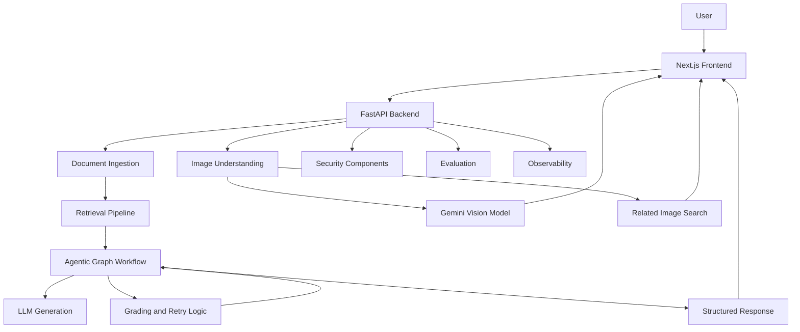

# RAG with Image Understanding

An AI-powered application that combines **Retrieval-Augmented Generation (RAG), agentic workflows, document intelligence, and multimodal image understanding** in a unified web application.

The system is designed to answer questions using relevant document context, analyze uploaded images, explain visual content, and provide a structured workflow for retrieval, generation, response evaluation, and security. It includes a web interface, a FastAPI backend, evaluation tools, and observability components.

**Repository:** [RAG-with-Image-Understanding](https://github.com/Ruthvik2910/RAG-with-Image-Understanding)

---

## Table of Contents

- [Overview](#overview)
- [Key Features](#key-features)
- [System Architecture](#system-architecture)
- [Technology Stack](#technology-stack)
- [Project Structure](#project-structure)
- [Installation and Setup](#installation-and-setup)
- [Environment Configuration](#environment-configuration)
- [Running the Application](#running-the-application)
- [Core Workflows](#core-workflows)
- [API Endpoints](#api-endpoints)
- [Evaluation and Observability](#evaluation-and-observability)
- [Security](#security)
- [Performance Optimization](#performance-optimization)
- [Troubleshooting](#troubleshooting)
- [Future Improvements](#future-improvements)
- [Author](#author)

## Overview

Traditional language models can generate fluent answers but may lack access to private documents, current project-specific knowledge, or the visual information contained in uploaded images.

This project addresses these challenges by integrating retrieval, language-model generation, agentic processing, and image understanding in one application.

The application includes a document-based RAG pipeline, a graph-based workflow for processing and evaluating responses, a multimodal image-question-answering feature, and supporting components for security, testing, evaluation, and observability.

The goal is to provide a flexible foundation for building AI assistants that can work with both textual knowledge and visual inputs.

## Key Features

### 1. Document Ingestion and Knowledge Retrieval

- Upload and manage documents through backend APIs.
- Process documents into content suitable for retrieval.
- Retrieve relevant context for user questions.
- Use retrieved information to support grounded answers.
- Integrate vector-store components for semantic retrieval.

### 2. Retrieval-Augmented Generation

- Combine retrieved context with language-model generation.
- Generate answers using relevant information from the knowledge base.
- Evaluate retrieved documents and generated responses.
- Support retrieval, generation, and retry workflows through the graph-based pipeline.

### 3. Agentic Workflow Orchestration

The backend includes a graph-based workflow with specialized nodes and chains for tasks such as:

- Query routing.
- Document retrieval.
- Document relevance grading.
- Answer generation.
- Hallucination and answer-quality grading.
- Retry handling.
- Web-search processing and approval workflows.
- Response construction and output security.

These components provide a structured approach to coordinating retrieval and generation rather than relying on a single unstructured model call for every operation.

### 4. Multimodal Image Understanding

- Upload images and ask natural-language questions.
- Identify the main subjects, objects, and important visual details.
- Interpret readable text, labels, numbers, and symbols.
- Explain diagrams, screenshots, and relationships between visual elements.
- Produce contextual answers based on image content.
- Search for related images when requested.

The image-processing workflow uses a configured Gemini model and supports a concise, moderately detailed answer format.

### 5. Web and Related-Image Search

- Support web-search operations within the graph workflow.
- Provide approval-related handling for supported search workflows.
- Search for related images when requested by the user.
- Use retrieved search results as additional context where applicable.

### 6. Security and Input Validation

The backend includes dedicated security components for:

- Input content checks.
- Prompt-injection handling.
- Output security checks.
- Security configuration.
- Handling instructions embedded in uploaded image content as untrusted input.

### 7. Evaluation and Observability

- Run benchmark-based evaluations.
- Store and inspect evaluation results.
- Generate evaluation reports.
- Support RAG evaluation workflows.
- Record application execution metrics and latency.
- Inspect observability data through the frontend.

### 8. Web Application Interface

The Next.js frontend provides an interface for interacting with the backend and includes pages for the main application, evaluation information, and observability data.

---

## System Architecture

The project is organized into a frontend, backend APIs, retrieval and generation components, graph-based orchestration, image processing, security, and evaluation utilities.



The diagram represents the main architectural components. The exact execution path depends on the endpoint and the workflow being used.

## Technology Stack

| Layer | Technologies |
|---|---|
| Frontend | Next.js, React, TypeScript |
| Backend | Python, FastAPI |
| Language and vision models | Google Gemini |
| LLM integration | LangChain Google GenAI |
| Retrieval and RAG | LangChain, semantic retrieval, Chroma-related components |
| Image and web search | Tavily integration |
| Workflow orchestration | Graph-based processing components |
| Evaluation | Python evaluation utilities and RAG evaluation scripts |
| Configuration | Environment variables and `.env` |
| Containerization | Docker, Docker Compose |

## Project Structure

```text
RAG-with-Image-Understanding/
├── backend/
│   ├── api.py
│   ├── main.py
│   ├── config.py
│   ├── model.py
│   ├── image_search.py
│   ├── ingestion.py
│   ├── retrieval.py
│   ├── response.py
│   ├── sources.py
│   ├── evaluation.py
│   ├── observability.py
│   ├── graph/
│   │   ├── chains/
│   │   ├── nodes/
│   │   ├── graph.py
│   │   ├── context.py
│   │   ├── consts.py
│   │   └── state.py
│   ├── security/
│   │   ├── content_guard.py
│   │   ├── output_guard.py
│   │   ├── prompt_guard.py
│   │   └── security_config.py
│   ├── documents/
│   └── evaluation/
├── frontend/
│   ├── src/
│   │   └── app/
│   │       ├── page.tsx
│   │       ├── evaluation/
│   │       └── observability/
│   ├── public/
│   ├── package.json
│   └── README.md
├── .env.example
├── .gitignore
├── Dockerfile
├── docker-compose.yml
├── requirements.txt
└── README.md
```

## Installation and Setup

### Prerequisites

Install the following tools:

- Python compatible with the project's dependencies.
- Node.js and npm.
- Git.
- A Google AI API key for the configured Gemini model.
- A Tavily API key if you use features that require Tavily search.

### 1. Clone the repository

```bash
git clone https://github.com/Ruthvik2910/RAG-with-Image-Understanding.git
cd RAG-with-Image-Understanding
```

### 2. Set up the Python environment

From the project root, create a virtual environment:

```bash
python -m venv .venv
```

Activate it on Windows PowerShell:

```powershell
.\.venv\Scripts\Activate.ps1
```

Install the backend dependencies:

```bash
python -m pip install -r requirements.txt
```

If PowerShell blocks environment activation, use an appropriate execution-policy setting for the current terminal or invoke the virtual environment's Python executable directly.

### 3. Configure environment variables

Create a local `.env` file using `.env.example` as your reference. For example:

```dotenv
GOOGLE_API_KEY=your_google_api_key
VISION_MODEL=gemini-3.5-flash-lite
```

Add the other variables required by the application and its optional integrations. Use placeholder values in `.env.example` and real credentials only in your local `.env`.

Do not commit `.env` or expose API keys in source code.

### 4. Start the backend

From the project root, with the virtual environment activated:

```bash
python -m uvicorn backend.api:app --reload
```

The backend should be available at:

- **API:** `http://127.0.0.1:8000`
- **Interactive API documentation:** `http://127.0.0.1:8000/docs`

Keep the backend terminal running.

### 5. Start the frontend

Open a second terminal:

```bash
cd frontend
npm install
npm run dev
```

Open the application:

**http://localhost:3000**

Keep both the frontend and backend processes running while using the application.

## Core Workflows

### Document Question Answering

1. A user submits a question or uploads a supported document.
2. The backend processes the request.
3. The retrieval pipeline finds relevant knowledge when required.
4. The graph workflow routes the request through the appropriate processing steps.
5. The generation component produces an answer using the available context.
6. Grading, retry, security, and response-building components participate according to the workflow.
7. The frontend displays the result.

### Image Question Answering

1. A user uploads an image and asks a question.
2. The image endpoint passes the image and question to the configured Gemini model.
3. The model interprets the visual content and generates a contextual answer.
4. The backend returns the answer and associated response metadata.
5. If related images are requested, the application can run additional image analysis and search operations.

The ordinary image-question path has been optimized to avoid an unnecessary separate image-analysis call. Additional analysis is performed when required for related-image search.

### Evaluation and Monitoring

1. Run the relevant evaluation script.
2. Inspect the resulting evaluation artifacts.
3. Use the evaluation and observability endpoints or frontend pages to examine available results.
4. Compare results and latency after making changes to the retrieval, generation, or image-processing pipeline.

## API Endpoints

The backend includes routes for chat, image question answering, document management, evaluation, observability, and workflow operations.

Important endpoints include:

| Method | Endpoint | Purpose |
|---|---|---|
| GET | `/` | Root endpoint |
| GET | `/health` | Health check |
| GET | `/documents` | List available documents |
| POST | `/upload` | Upload documents |
| DELETE | `/documents/{document_id}` | Delete a document |
| POST | `/chat` | Submit a chat question |
| POST | `/chat/image` | Ask a question about an image |
| POST | `/chat/approval` | Handle approval-related workflow |
| GET | `/evaluation` | Retrieve evaluation information |
| DELETE | `/evaluation` | Clear evaluation data |
| GET | `/observability` | Retrieve observability information |
| DELETE | `/observability` | Clear observability data |

Additional routes and request requirements may be present in the current implementation. The running API documentation at `http://127.0.0.1:8000/docs` is the authoritative reference for available operations and request schemas.

## Evaluation and Observability

The repository contains scripts and components for assessing application behavior and inspecting performance.

Relevant files include:

- `backend/evaluation.py`
- `backend/evaluation/run_benchmark.py`
- `backend/evaluation/run_ragas.py`
- `backend/evaluation/generate_report.py`
- `backend/observability.py`

These components support evaluation workflows, benchmark execution, report generation, and application monitoring.

Run an evaluation script from the project root using the active Python environment. Check the script's arguments and configuration before executing it, as different evaluation tasks may require separate dependencies, datasets, credentials, or model access.

## Performance Optimization

The image-question-answering workflow has been optimized through:

- Using a Flash-Lite Gemini model for image requests.
- Removing an unnecessary second model call for ordinary image questions.
- Simplifying the image-answering prompt while preserving useful detail.
- Using a moderately detailed response format.
- Measuring model request duration with latency logs.

During local testing, image-model request time was reduced from several minutes to a few seconds. The measured time varied with the model and prompt; actual latency depends on service availability, network conditions, image complexity, and answer length.

Performance should be evaluated across the complete application, not just the image endpoint. Retrieval, document processing, graph execution, external search, and frontend communication can contribute additional latency.

## Security and Configuration

- Keep real credentials in `.env`.
- Keep `.env` excluded through `.gitignore`.
- Use `.env.example` to document required variables without publishing secrets.
- Treat user uploads and embedded image instructions as untrusted input.
- Avoid committing sensitive documents or private evaluation data.
- Review API exposure and environment configuration before deploying publicly.

## Docker and Deployment

The repository includes:

- `Dockerfile`
- `docker-compose.yml`
- `frontend/Dockerfile`

These files provide containerization support. Before deploying, review the Docker configuration, required environment variables, service networking, persistent storage requirements, and production server settings.

Local development instructions above are the recommended starting point for verifying that the application works before deployment.

## Troubleshooting

### Backend fails to start

- Activate the intended Python environment.
- Install dependencies from `requirements.txt`.
- Check for missing environment variables and import errors.
- Review the terminal output for the actual failure.

### Frontend fails to start

- Verify Node.js and npm are accessible.
- Run `npm install` in the `frontend` directory.
- Check for dependency, configuration, or compilation errors.

### Gemini requests fail

- Confirm that the API key is valid and loaded.
- Verify that the configured model is available to your API project.
- Review the backend logs for errors such as `503 UNAVAILABLE` and `504 Deadline Exceeded`.
- Distinguish service-capacity errors from application-code errors.

### RAG answers are inaccurate

- Check whether relevant documents were ingested.
- Verify that retrieval returns appropriate context.
- Inspect retrieval grading and generation behavior.
- Use the evaluation scripts to compare changes.

### Responses are slow

- Measure the latency of individual stages where possible.
- Compare retrieval, generation, image analysis, and external search separately.
- Test with repeatable inputs and avoid judging performance from a single request.

## Future Improvements

Potential areas for further development include:

- More comprehensive retrieval and answer-quality evaluation.
- Improved OCR accuracy for small or low-resolution text.
- More efficient document ingestion and retrieval.
- Better latency monitoring across the entire workflow.
- Expanded automated tests for text, document, and image queries.
- Improved deployment automation and production observability.
- Additional user-facing controls for sources, confidence, and response detail.


If you find the project useful, consider starring the repository.

**Repository:** [RAG-with-Image-Understanding](https://github.com/Ruthvik2910/RAG-with-Image-Understanding)
